# Evidencias de pruebas funcionales: FUN-01 a FUN-04

**Proyecto:** Gestión de Casos Jurídicos
**Ambiente:** local (front `http://localhost:3000`, back `http://localhost:8080`)
**Fecha de ejecución:** 16/11/2026

> Las capturas referenciadas están en esta misma carpeta. Los tokens de sesión (`access_token`, `XSRF-TOKEN`, `x-xsrf-token`) fueron reemplazados por `[REDACTADO]`.

## Resumen

| ID | Módulo | Resultado |
|---|---|---|
| FUN-01 | Consulta | ✅ Aprobado |
| FUN-02 | Proceso | ✅ Aprobado |
| FUN-03 | Seguimientos | ✅ Aprobado, con ajuste menor de UI |
| FUN-04 | Conciliaciones | ✅ Aprobado |

---

## FUN-01 · Consulta

### Creación

Se crea la consulta **id = 20** con los siguientes datos:

| Campo | Valor |
|---|---|
| Fecha | 11/16/2026 |
| Estado | Pendiente |
| Trámite | Conciliación |
| Sede | Centro de Conciliación UFPS |
| Área | Derecho administrativo |
| Tema | Derecho de petición |
| Tipo | Solicitud administrativa |
| Parte principal | Andrea Paola Rojas Sánchez |
| Descripción | FUN-01 |
| Hechos | FUN-01 |
| Pretensiones | FUN-01 |
| Concepto jurídico | FUN-01 |

### Persistencia tras recargar la página

Tras recargar, todos los campos se conservan idénticos a los de la creación. ✅

### Regla de negocio: cambio de asesor

**Regla seleccionada:** cambio de asesor. El asesor debe pertenecer a la misma área de la consulta.

#### Front

Los asesores mostrados corresponden solo a los que cumplen la regla (misma área de la consulta).


#### Back

**Caso 1. Cambio bajo las reglas establecidas** (asesor válido)

```http
PATCH /api/consultas/20/responsable HTTP/1.1
Host: localhost:8080
Origin: http://localhost:3000
Referer: http://localhost:3000/
content-type: application/json
x-request-id: f77a4a99-e100-46cf-bd82-2be476331654
x-xsrf-token: [REDACTADO]
Cookie: access_token=[REDACTADO]; XSRF-TOKEN=[REDACTADO]
```

```json
{"tipoResponsable":"ASESOR","nuevoResponsableId":3,"motivo":"nomas","version":0}
```

**Caso 2. Asesor que NO cumple la regla**

Se modifica el body de la petición: `nuevoResponsableId` a `1` (asesor que no cumple la regla) y `version` a `1` (para que no falle por versionamiento y la prueba se centre en la regla de negocio).

Respuesta:

```http
HTTP/1.1 400
X-Request-ID: 12dd3f54-db74-4860-bb33-c78e3d9963d5
Content-Type: application/json
Date: Mon, 16 Nov 2026 23:16:52 GMT
```

```json
{
  "fecha": "2026-11-16T23:16:52.046504977",
  "estado": 400,
  "error": "Error de negocio",
  "mensaje": "El asesor asignado no pertenece al área de la consulta",
  "ruta": "/api/consultas/20/responsable",
  "correlacionId": "12dd3f54-db74-4860-bb33-c78e3d9963d5"
}
```

**Resultado:** el asesor no cambia. El back rechaza la asignación inválida con el mensaje esperado.

### Resultado FUN-01: ✅ Aprobado

---

## FUN-02 · Proceso

### Creación

| Campo | Valor |
|---|---|
| Departamento | Norte de Santander |
| Consulta | #20 - FUN-01 (id=20) |
| Órgano de control | Juzgado Civil Municipal de Cúcuta |
| Especialidad | Civil |

Body enviado:

```json
{"numeroRadicado":null,"departamentoId":1,"consultaId":20,"organoControlId":2,"especialidadId":2}
```

### Inspección

Estado del proceso creado:

```json
{"id":4,"version":0,"numeroRadicado":null,"departamentoId":1,"consultaId":20,"especialidadId":2,"organoControlId":2,"estado":"PENDIENTE","activo":true}
```

### Nuevo radicado

La regla indica que el radicado debe tener **exactamente 23 caracteres**.

**Validación en el front.** Un radicado que no cumple el estándar (20 caracteres) es rechazado desde la interfaz, sin enviar petición al back.


Un radicado que cumple el estándar es aceptado correctamente:

```json
{"id":4,"version":1,"numeroRadicado":"01234567890123456789012","departamentoId":1,"consultaId":20,"especialidadId":2,"organoControlId":2,"estado":"PENDIENTE","activo":true}
```

**Validación en el back (desde Insomnia).** Se prueba la petición directamente, saltando la validación del front.

*Radicado válido (23 caracteres):*

```http
HTTP/1.1 200
X-Request-ID: 4dac2c31-1391-493a-ad21-2696f35c1a80
Content-Type: application/json
Date: Mon, 16 Nov 2026 23:45:35 GMT
```

```json
{"id":4,"version":2,"numeroRadicado":"01234567890123456789013","departamentoId":1,"consultaId":20,"especialidadId":2,"organoControlId":2,"estado":"PENDIENTE","activo":true}
```

*Radicado inválido:*

```http
HTTP/1.1 400
X-Request-ID: 282120d7-8d99-4a21-883d-990e8faad386
Content-Type: application/json
Date: Mon, 16 Nov 2026 23:59:09 GMT
```

```json
{
  "fecha": "2026-11-16T23:59:09.186066244",
  "estado": 400,
  "error": "Error de negocio",
  "mensaje": "El número de radicado debe tener exactamente 23 caracteres",
  "ruta": "/api/procesos/4",
  "correlacionId": "282120d7-8d99-4a21-883d-990e8faad386"
}
```

**Resultado:** la validación del radicado se aplica tanto en el front como en el back. ✅

### Resultado FUN-02: ✅ Aprobado

---

## FUN-03 · Seguimientos

| Paso | Resultado | Evidencia |
|---|---|---|
| Formulario de seguimientos | ⚠️ Error de UI: los campos obligatorios no tienen asterisco (\*) | 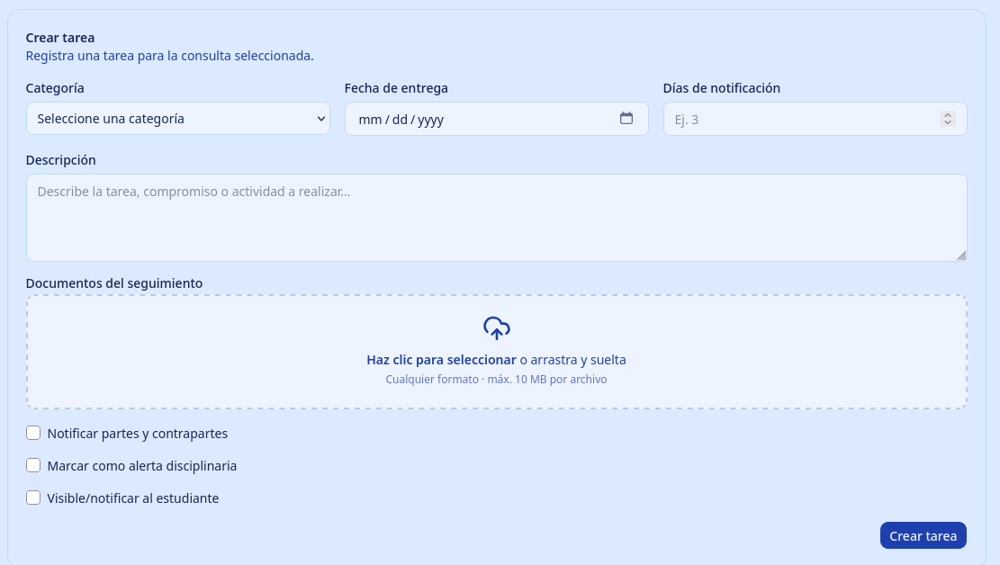 |
| Creación de la tarea | ✅ La tarea se crea adecuadamente | 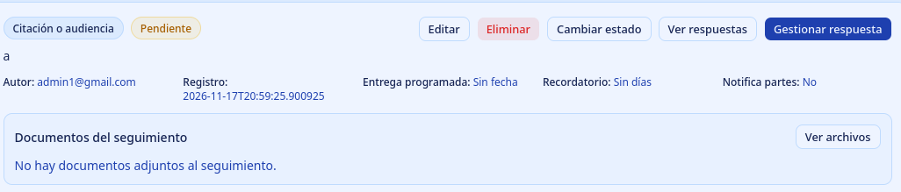 |
| Visibilidad para el estudiante | ✅ El estudiante puede ver la tarea | 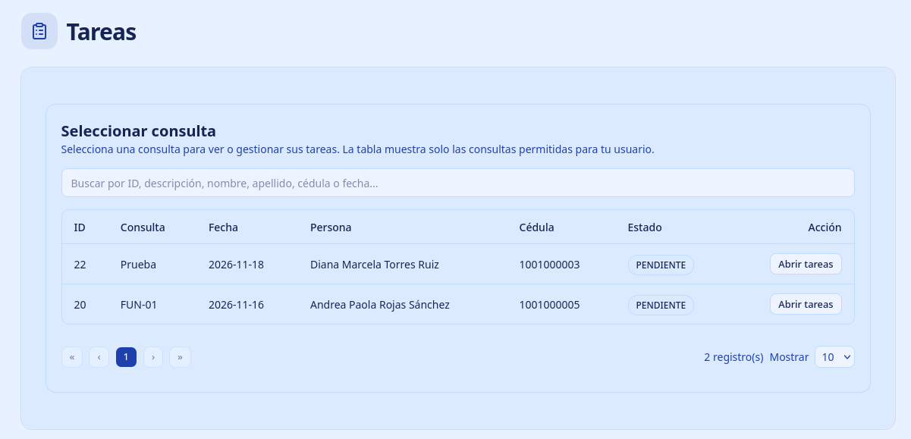 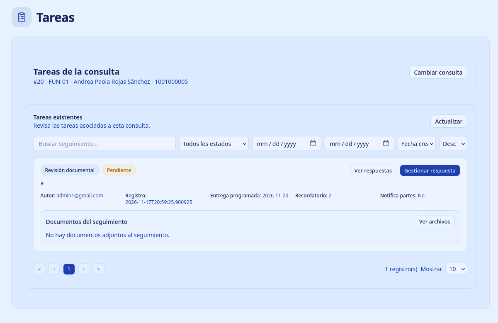 |
| Respuesta del estudiante | ✅ La respuesta se registra correctamente | 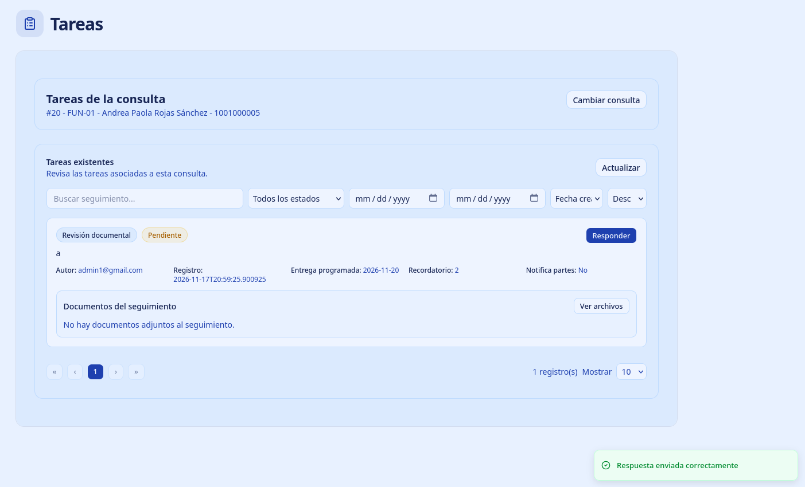 |
| Respuesta pendiente en vista docente | ✅ La respuesta aparece como "por calificar" | 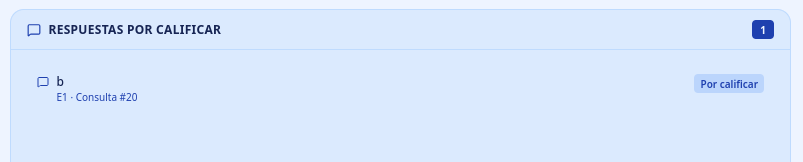 |
| Revisión del docente | ✅ El docente puede aceptar o rechazar la respuesta | 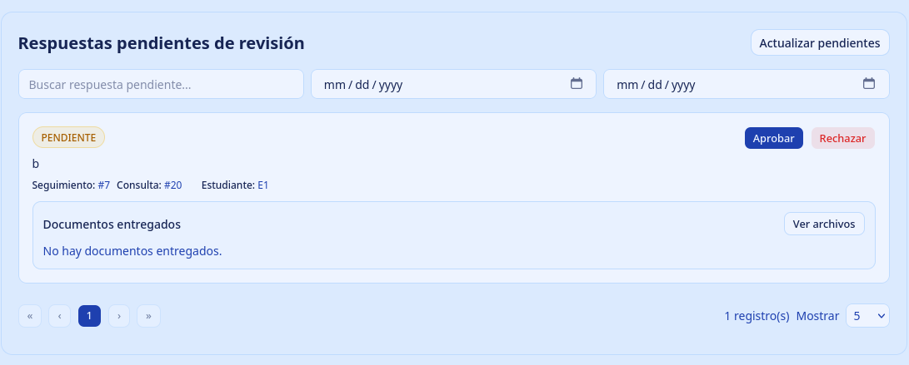 |

### Hallazgo

- **UI:** el formulario de seguimientos no marca con asterisco (\*) los campos obligatorios. Es un ajuste menor que no afecta el flujo funcional.

### Resultado FUN-03: ✅ Aprobado, con ajuste menor de UI

---

## FUN-04 · Conciliaciones

| Paso | Resultado | Evidencia |
|---|---|---|
| Creación de la conciliación | ✅ Se crea una conciliación con la actividad 20 | 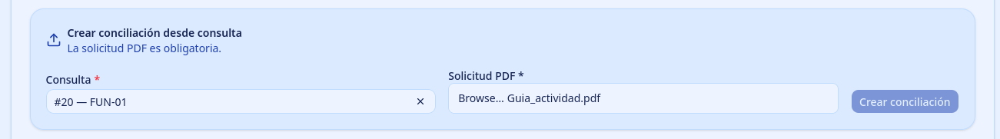 |
| Listado inmediato | ✅ La conciliación es listada inmediatamente |  |
| Listado para programar reuniones | ✅ Se listan las conciliaciones para programar reuniones | 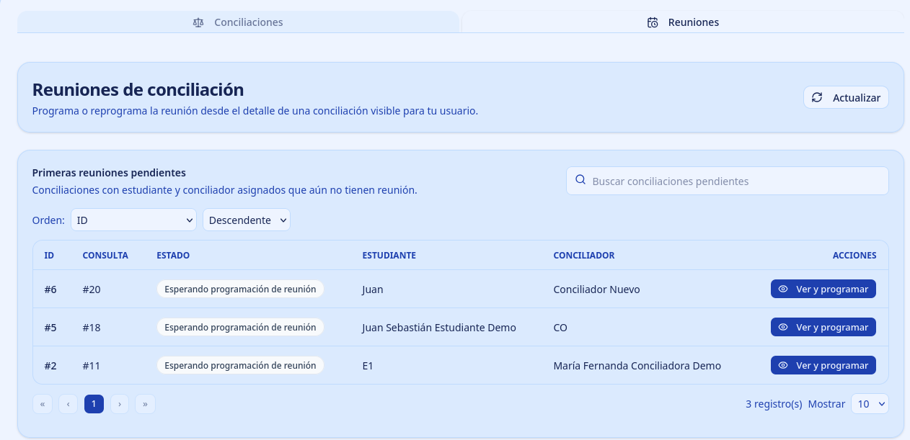 |
| Programación de la reunión | ✅ Se programa la reunión adecuadamente | 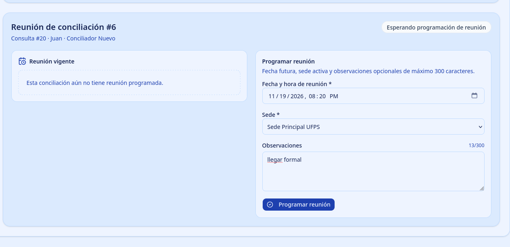 |
| Vista de quien programó | ✅ La reunión se lista adecuadamente para quien la programó | 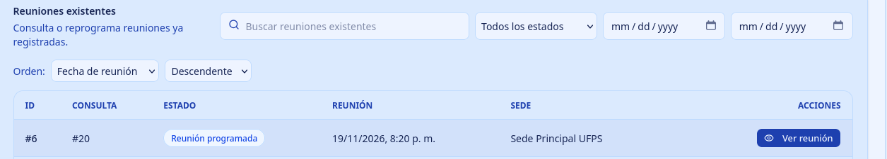 |
| Vista del estudiante (conciliación) | ✅ La conciliación se lista correctamente | 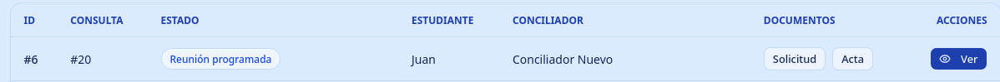 |
| Vista del estudiante (detalle) | ✅ Se detalla correctamente la conciliación con la reunión | 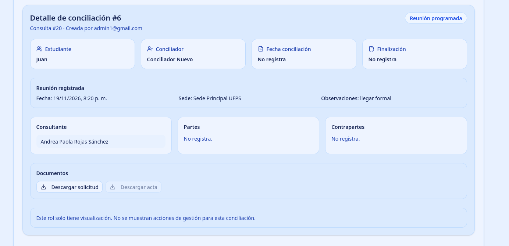 |

La conciliación aparece en el listado y la opción de programar la reunión está disponible, por lo que **no se reproduce el defecto de [SCRUM-381](https://gestion-casos-juridicos.atlassian.net/browse/SCRUM-381)**.

### Resultado FUN-04: ✅ Aprobado

---

## Veredicto

Los cuatro casos (FUN-01 a FUN-04) se ejecutaron correctamente.

- **Ajuste pendiente (menor):** añadir el asterisco (\*) a los campos obligatorios del formulario de seguimientos.
