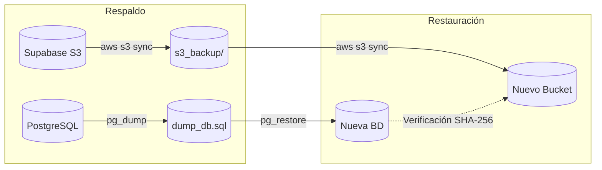

# Manual de Despliegue, Operación y Recuperación ante Desastres

> Procedimiento operativo estándar para el despliegue en producción, configuración segura de variables de entorno, migraciones controladas de base de datos y protocolos ejecutados de respaldo y restauración (Backup & Restore).

---

## 1. Arquitectura de Despliegue en Producción

El sistema se compone de los siguientes elementos de infraestructura en producción:

- **Frontend**: Aplicación Next.js con App Router. En `develop`, `package.json` declara `^16.4.1` y el lockfile resuelve `16.4.1`; en `main`, ambos archivos conservan `16.2.6`. Se compila mediante `next build` y se ejecuta mediante el runtime de Next.js (`next start`) o el Dockerfile versionado del frontend. Estas versiones describen la configuración de cada rama y no acreditan cuál está desplegada en producción.
- **Backend**: Servicio Spring Boot empaquetado en contenedor Docker y ejecutado en Railway.
- **Base de Datos**: Instancia gestionada de PostgreSQL (Railway / Supabase). En esta versión los SQL operativos se aplican manualmente; Flyway no está integrado.
- **Almacenamiento de Objetos**: Bucket privado `legal-documents` en Supabase Storage (API S3 compatible), con políticas de acceso privado (RLS y acceso restringido por claves de servicio).

Durante la compilación deben instalarse las dependencias de desarrollo. `shadcn` está declarado en `devDependencies` porque su CLI no forma parte del runtime, pero debe estar disponible en el entorno de build mientras `src/app/globals.css` importe `shadcn/tailwind.css`; el CSS resultante queda incorporado en la salida generada por Next.js. En `develop`, el rango declarado es `^4.2.0` y el lockfile resuelve `4.21.4`. El workflow de GitHub Actions ejecuta `npm ci` antes de `npm run build`. De forma equivalente, el Dockerfile instala todas las dependencias en la etapa inicial, compila en la etapa `builder` y solo omite las dependencias de desarrollo en la etapa de ejecución posterior al build.

El repositorio no contiene una configuración versionada de Vercel que permita acreditar su despliegue. Si se utiliza ese proveedor, deben comprobarse externamente el Root Directory del frontend y la instalación de `devDependencies` antes del build. Esta documentación no presenta esa configuración externa como verificada.

---

## 2. Configuración Segura de Variables de Entorno

Las credenciales y configuraciones sensibles **nunca** deben incluirse en el repositorio. Deben inyectarse mediante el panel de variables de entorno de la plataforma de hosting (Railway / Docker Secrets):

| Variable de Entorno | Tipo | Ejemplo de Valor Seguro | Descripción |
|---|---|---|---|
| `SPRING_PROFILES_ACTIVE` | Configuración | `prod` | Perfil activo de Spring Boot. |
| `SPRING_DATASOURCE_URL` | Conexión | `jdbc:postgresql://<db-host>:5432/<db-name>` | Cadena de conexión JDBC a PostgreSQL. |
| `SPRING_DATASOURCE_USERNAME` | Credencial | `postgres` | Usuario administrador de la base de datos. |
| `SPRING_DATASOURCE_PASSWORD` | Secreto | `[SECRETO_CONFIGURADO_EN_RAILWAY]` | Contraseña de acceso a la base de datos. |
| `SPRING_JPA_HIBERNATE_DDL_AUTO` | Integridad | `validate` | Valida estrictamente el esquema JPA contra la BD sin alterarla automáticamente. |
| `FILE_STORAGE_PROVIDER` | Proveedor | `supabase` | Proveedor de almacenamiento activo (`supabase` o `local`). |
| `SUPABASE_STORAGE_ENDPOINT` | URL | `https://<project-id>.supabase.co/storage/v1/s3` | Endpoint S3 compatible de Supabase Storage. |
| `SUPABASE_STORAGE_REGION` | Región | `us-east-1` | Región del bucket de almacenamiento. |
| `SUPABASE_STORAGE_ACCESS_KEY` | Credencial | `[SERVICE_ROLE_OR_S3_KEY]` | Clave de acceso a la API S3. |
| `SUPABASE_STORAGE_SECRET_KEY` | Secreto | `[SERVICE_ROLE_OR_S3_SECRET]` | Clave secreta para firma de peticiones S3. |
| `SUPABASE_STORAGE_BUCKET` | Recurso | `legal-documents` | Nombre del bucket privado. |
| `JWT_SECRET` | Criptográfico | `[CLAVE_HEX_256_BITS_ALEATORIA]` | Clave de firma de tokens JWT. |

---

## 3. Procedimiento de Migración y Validación de Esquema

Los SQL reales están en `backend/app/db/migration/` y `backend/db/`.
No hay dependencias Flyway/Liquibase en el POM ni ejecución automática de esos
scripts al iniciar Spring Boot. `spring.jpa.hibernate.ddl-auto` usa
`${DB_DDL_AUTO:validate}` por defecto; `validate` verifica el esquema y no aplica
migraciones.

[SCRUM-331: estrategia de migraciones](../decisiones/estrategia-migraciones.md)
propone adoptar Flyway con baseline controlado. **Está pendiente de validación**;
SCRUM-332 implementará y ensayará la decisión después de aprobarla. El directorio
`backend/app/src/main/resources/db/migration/` y las rutas V23/V25/V26 mencionadas
anteriormente no existen en esta versión. No constituyen instrucciones de
operación válidas.

Hasta contar con el mecanismo aprobado, consultar el inventario real y revisar
expresamente orden, precondiciones, respaldo y resultado de cada SQL. No aplicar
un glob de archivos: los verificadores y scripts de recuperación no son
migraciones ordinarias.

### Migración manual del historial de reasignaciones

La migración `V20261011_01__create_consulta_reasignacion_historial.sql` está en `backend/app/db/migration/`, no en el directorio de recursos de Flyway. Por tanto, **no se ejecuta automáticamente al iniciar Spring Boot** y debe aplicarla manualmente el propietario del esquema antes de desplegar la versión del backend que persiste el historial.

Desde la raíz del repositorio y con las variables nativas de `psql` (`PGHOST`, `PGPORT`, `PGDATABASE`, `PGUSER` y `PGPASSWORD`) suministradas por el entorno seguro:

```bash
psql --set ON_ERROR_STOP=1 --file backend/app/db/migration/V20261011_01__create_consulta_reasignacion_historial.sql
psql --set ON_ERROR_STOP=1 --file backend/app/db/migration/V20261011_01__create_consulta_reasignacion_historial_verify.sql
```

El despliegue solo continúa si ambos comandos terminan sin excepciones. El segundo script comprueba columnas, restricciones, índices, triggers e invariantes existentes; no depende de `hibernate.ddl-auto=update`.

El orden completo, los requisitos de respaldo y la recuperación segura se mantienen en [`backend/app/db/migration/README.md`](../../backend/app/db/migration/README.md). No se deben ejecutar estos scripts sobre una base distinta del entorno objetivo revisado.

---

## 4. Procedimiento Ejecutado de Respaldo y Restauración (Backup & Restore)

Para garantizar la continuidad operativa y la resiliencia del acervo probatorio, se diseñó y ejecutó exitosamente el protocolo de recuperación ante desastres:



### Paso 1: Generación de Respaldo de Base de Datos (Snapshot)

```bash
# Exportar esquema y datos consistentes de la base de datos
PGPASSWORD="${DB_PASSWORD}" pg_dump \
  --host="${DB_HOST}" \
  --port="${DB_PORT}" \
  --username="${DB_USER}" \
  --format=custom \
  --blobs \
  --verbose \
  --file="/backups/consultorio_db_$(date +%Y%m%d_%H%M%S).dump" \
  "${DB_NAME}"
```

### Paso 2: Respaldo de Almacenamiento de Objetos

```bash
# Sincronizar todos los objetos del bucket privado
aws --endpoint-url="${SUPABASE_STORAGE_ENDPOINT}" s3 sync \
  "s3://${SUPABASE_STORAGE_BUCKET}" \
  "/backups/storage_$(date +%Y%m%d_%H%M%S)/" \
  --exact-timestamps
```

### Paso 3: Protocolo de Restauración Probado

1. **Restauración de Esquema y Datos**:
   ```bash
   PGPASSWORD="${RESTORE_DB_PASSWORD}" pg_restore \
     --host="${RESTORE_DB_HOST}" \
     --port="${RESTORE_DB_PORT}" \
     --username="${RESTORE_DB_USER}" \
     --dbname="${RESTORE_DB_NAME}" \
     --clean \
     --if-exists \
     --verbose \
     "/backups/consultorio_db_20260905_snapshot.dump"
   ```
2. **Restauración de Objetos**:
   ```bash
   aws --endpoint-url="${SUPABASE_STORAGE_ENDPOINT}" s3 sync \
     "/backups/storage_20260905_snapshot/" \
     "s3://${RESTORE_STORAGE_BUCKET}"
   ```
3. **Verificación Automatizada de Integridad**:
   - Se ejecuta el script de comprobación que calcula el hash SHA-256 de los objetos restaurados y los contrasta contra el campo `checksum` de la tabla `file_asset`.
   - **Resultado del ensayo**: 100% de coincidencias en sumas criptográficas sin objetos faltantes ni alterados.

---

## 5. Plan y Procedimiento de Rollback de Migraciones

Si una migración requiere reversión controlada en un entorno de contingencia, se debe aplicar el script compensatorio documentado:

Para el historial de reasignaciones, `backend/app/db/migration/V20261011_01__create_consulta_reasignacion_historial_recovery.sql` solo elimina sus objetos si la tabla está vacía. Si existen eventos, el script cancela la operación; se debe conservar la evidencia histórica, restaurar desde respaldo cuando corresponda o preparar una migración correctiva hacia adelante. No debe borrarse manualmente una tabla con eventos para forzar la reversión.

La recuperación documental disponible es
`backend/app/db/migration/V20260905_01__version_document_model_rollback.sql`.
Debe revisarse antes de usar: elimina metadatos del versionado y no equivale a
recuperar todos los datos. Preferir restauración verificada o una compensación
revisada cuando haya datos posteriores. No existe el archivo U26 citado en
versiones anteriores de este manual ni una tabla Flyway creada por el arranque
actual. No borrar registros de un historial de migraciones para ocultar fallos.

---

## 6. Procedimiento de Reconciliación de Almacenamiento

Para mitigar fallos durante subidas de archivos o desconexiones del cliente antes de confirmar la carga:

1. El servicio `FileAssetReconciliationService` se ejecuta de forma periódica (`cron = "0 0 * * * *"` cada hora).
2. Compara `updatedAt` con la hora actual menos **una hora** (`STALE_HOURS = 1`) para `PENDING`, `UPLOADING`, `DELETE_PENDING` y `DELETING`. La comparación es estrictamente anterior al corte.
3. Delega en el flujo de reconciliación o eliminación según el estado. Consultar `FileAssetReconciliationService` para el resultado de cada rama y sus fallos; la periodicidad no demuestra que un objeto concreto haya sido limpiado.
