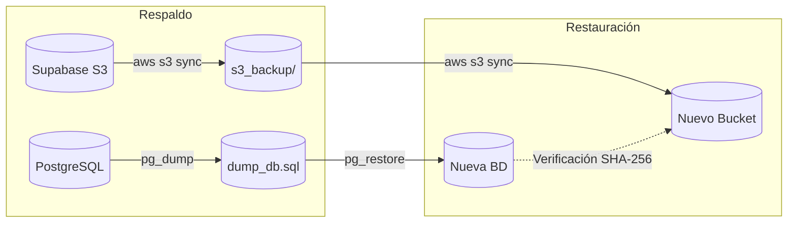

# Manual de Despliegue, Operación y Recuperación ante Desastres

> Procedimiento operativo estándar para el despliegue, la configuración segura de variables de entorno, las migraciones controladas de base de datos y la preparación de respaldo y restauración (Backup & Restore). Los comandos de recuperación son una guía operativa; solo un acta de ensayo con ambiente, muestra y evidencia permite presentarlos como ejecutados.

---

## 1. Arquitectura de Despliegue en Producción

El sistema se compone de los siguientes elementos de infraestructura en producción:

- **Frontend**: Aplicación Next.js con App Router. En la línea base histórica `v1.1.0`, `package.json` y el lockfile conservan Next.js `16.2.6`. En el incremento candidato, `package.json` declara `^16.4.1` y el lockfile resuelve `16.4.1`. Se compila mediante `next build` y se ejecuta mediante el runtime de Next.js (`next start`) o el Dockerfile versionado del frontend. La versión efectivamente desplegada se confirma contra el commit del ambiente, no por la presencia de estos archivos en una rama.
- **Backend**: Servicio Spring Boot empaquetado en contenedor Docker y ejecutado en Railway.
- **Base de Datos**: PostgreSQL 16 con migraciones Flyway ejecutadas por un artefacto separado antes de iniciar el backend. El proceso web únicamente valida el historial de Flyway y el esquema de Hibernate; no aplica DDL.
- **Almacenamiento de Objetos**: Bucket privado `legal-documents` en Supabase Storage (API S3 compatible), con políticas de acceso privado (RLS y acceso restringido por claves de servicio).

Durante la compilación deben instalarse las dependencias de desarrollo. `shadcn` está declarado en `devDependencies` porque su CLI no forma parte del runtime, pero debe estar disponible en el entorno de build mientras `src/app/globals.css` importe `shadcn/tailwind.css`; el CSS resultante queda incorporado en la salida generada por Next.js. En el incremento candidato, el rango declarado es `^4.2.0` y el lockfile resuelve `4.21.4`. El workflow de GitHub Actions ejecuta `npm ci` antes de `npm run build`. De forma equivalente, el Dockerfile instala todas las dependencias en la etapa inicial, compila en la etapa `builder` y solo omite las dependencias de desarrollo en la etapa de ejecución posterior al build.

El repositorio no contiene una configuración versionada de Vercel que permita acreditar su despliegue. Si se utiliza ese proveedor, deben comprobarse externamente el Root Directory del frontend y la instalación de `devDependencies` antes del build. Esta documentación no presenta esa configuración externa como verificada.

---

## 2. Configuración Segura de Variables de Entorno

Las credenciales y configuraciones sensibles **nunca** deben incluirse en el repositorio. Deben inyectarse mediante el panel de variables de entorno de la plataforma de hosting (Railway / Docker Secrets):

| Variable de Entorno | Tipo | Ejemplo de Valor Seguro | Descripción |
|---|---|---|---|
| `SPRING_PROFILES_ACTIVE` | Configuración | `prod` | Perfil activo de Spring Boot. |
| `DB_URL` | Conexión runtime | `jdbc:postgresql://<db-host>:5432/<db-name>` | URL JDBC usada por la aplicación. No debe incluir usuario ni contraseña. |
| `DB_USERNAME` | Credencial runtime | `app_runtime` | Cuenta de aplicación con DML y sin permisos DDL. |
| `DB_PASSWORD` | Secreto runtime | `[SECRETO_CONFIGURADO_EN_EL_HOST]` | Contraseña de la cuenta de aplicación. |
| `DB_DDL_AUTO` | Integridad | `validate` | Mantiene Hibernate en validación sin alterar automáticamente el esquema. |
| `MIGRATION_DB_URL` | Conexión de migración | `jdbc:postgresql://<db-host>:5432/<db-name>` | URL JDBC del job de migración; no admite credenciales embebidas. |
| `MIGRATION_DB_USERNAME` | Credencial de migración | `migration_owner` | Cuenta temporal del job con propiedad/DDL sobre el esquema. No se reutiliza en el runtime. |
| `MIGRATION_DB_PASSWORD` | Secreto de migración | `[SECRETO_DEL_JOB]` | Contraseña separada del job de migración. |
| `MIGRATION_ENVIRONMENT` | Trazabilidad | `staging` | Identificador sanitizado del ambiente objetivo. |
| `MIGRATION_RELEASE` | Trazabilidad | `<SHA_GIT_DE_40_HEX>` | Commit exacto del artefacto desplegado. |
| `FILE_STORAGE_PROVIDER` | Proveedor | `supabase` | Proveedor de almacenamiento activo (`supabase` o `local`). |
| `SUPABASE_STORAGE_ENDPOINT` | URL | `https://<project-id>.supabase.co/storage/v1/s3` | Endpoint S3 compatible de Supabase Storage. |
| `SUPABASE_STORAGE_REGION` | Región | `us-east-1` | Región del bucket de almacenamiento. |
| `SUPABASE_STORAGE_ACCESS_KEY` | Credencial | `[SERVICE_ROLE_OR_S3_KEY]` | Clave de acceso a la API S3. |
| `SUPABASE_STORAGE_SECRET_KEY` | Secreto | `[SERVICE_ROLE_OR_S3_SECRET]` | Clave secreta para firma de peticiones S3. |
| `SUPABASE_STORAGE_BUCKET` | Recurso | `legal-documents` | Nombre del bucket privado. |
| `JWT_SECRET` | Criptográfico | `[CLAVE_HEX_256_BITS_ALEATORIA]` | Clave de firma de tokens JWT. |
| `CORS_ALLOWED_ORIGINS` | Configuración | `https://<frontend-host>` | Orígenes frontend autorizados, separados por coma cuando exista más de uno. |
| `AUTH_COOKIE_SECURE` | Configuración | `true` | Exige HTTPS para transportar `access_token`. |
| `AUTH_COOKIE_SAME_SITE` | Configuración | `None` | Política SameSite de la cookie JWT. |
| `CSRF_COOKIE_SECURE` | Configuración | `true` | Exige HTTPS para transportar la cookie CSRF. |
| `CSRF_COOKIE_SAME_SITE` | Configuración | `None` | Política SameSite de la cookie CSRF. |
| `FRONTEND_URL` | Configuración | `https://<frontend-host>` | Base usada para construir enlaces públicos de recuperación. |
| `BREVO_API_KEY` | Secreto runtime | `[SECRETO_CONFIGURADO_EN_EL_HOST]` | Credencial del proveedor de correo transaccional. |
| `MAIL_FROM_EMAIL` | Identidad de envío | `no-reply@<dominio-verificado>` | Remitente verificado utilizado por el backend. |

---

### Procedimiento de configuración y cambio de credenciales

1. Registrar cada secreto en el almacén de variables del ambiente objetivo; no
   incluirlo en `.env.example`, commits, URLs, capturas ni logs.
2. Mantener separadas las credenciales de runtime y migración de PostgreSQL.
3. Al cambiar `DB_PASSWORD`, actualizar la cuenta de PostgreSQL y después la
   variable del servicio que utiliza esa cuenta.
4. Al cambiar `JWT_SECRET`, actualizar el secreto del backend; los JWT firmados
   con el valor anterior dejan de ser aceptados.
5. Al cambiar `BREVO_API_KEY`, crear o rotar la clave en el proveedor y
   reemplazar `BREVO_API_KEY` en el backend conservando `MAIL_FROM_EMAIL` como
   remitente verificado.
6. Al cambiar las credenciales S3, reemplazar conjuntamente
   `SUPABASE_STORAGE_ACCESS_KEY` y `SUPABASE_STORAGE_SECRET_KEY` en el backend.
7. Mantener `CORS_ALLOWED_ORIGINS`, `FRONTEND_URL`, atributos de cookies y URL
   pública del frontend consistentes con el ambiente desplegado.
8. Reiniciar el servicio después de modificar variables y verificar inicio de
   sesión, consulta de sesión, correo transaccional y acceso al almacenamiento
   con datos sintéticos.

La configuración versionada usa marcadores y valores no sensibles. Las
contraseñas de usuarios, documentos de identidad, tokens de recuperación y
tokens de activación no son variables de despliegue ni credenciales que deban
compartirse con operadores.

---

## 3. Procedimiento de Migración y Validación de Esquema

El mecanismo vigente usa Flyway de forma controlada, pero **no migra desde el
arranque web**. El build produce `backend/app/target/legal-cases-backend.jar` y
`backend/app/target/legal-cases-backend-migrations.jar`. El segundo artefacto es
el único autorizado para ejecutar `migrate`, `validate`, `baseline` o `inspect`;
el backend aplica solamente `flyway.validate()` antes de crear el
`EntityManagerFactory` y conserva `${DB_DDL_AUTO:validate}`.

La única ubicación descubierta automáticamente es
`backend/app/src/main/resources/db/migration/`. Actualmente contiene el baseline
`V20261015_01__baseline_current_schema.sql`, cubierto por el manifiesto de hashes
empaquetado. `backend/app/db/migration/` y `backend/db/` contienen SQL históricos,
verificadores y recuperaciones para consulta o ejecución explícita revisada; no
se deben pasar completos a Flyway ni ejecutar mediante un glob. Las referencias
históricas V23, V25, V26 y U26 no existen y no son instrucciones válidas.

### Secuencia controlada de despliegue

1. Identificar el commit de 40 caracteres, el ambiente y el artefacto exacto.
2. Crear y verificar un respaldo antes de modificar una base con datos. Registrar
   el SHA-256, la ubicación protegida, la muestra verificada y el responsable.
3. Construir una sola vez desde `backend/app/`:

   ```bash
   ./mvnw -DskipTests package
   ```

4. Inyectar `MIGRATION_DB_URL`, `MIGRATION_DB_USERNAME`,
   `MIGRATION_DB_PASSWORD`, `MIGRATION_ENVIRONMENT` y `MIGRATION_RELEASE` en el
   job aislado. No reutilizar `DB_USERNAME`/`DB_PASSWORD` ni incluir secretos en
   la URL o el log.
5. Para una base vacía, ejecutar y validar el artefacto empaquetado:

   ```bash
   java -jar target/legal-cases-backend-migrations.jar migrate
   java -jar target/legal-cases-backend-migrations.jar validate
   ```

6. Para una base legada, ejecutar primero `inspect` y comparar el contrato. Solo
   si la equivalencia fue revisada, el respaldo fue comprobado y no existe
   `flyway_schema_history`, autorizar `baseline` con
   `MIGRATION_BASELINE_ACK=20261015.01` y `MIGRATION_BACKUP_SHA256=<64-hex>`.
   Una base divergente se detiene y requiere una migración correctiva nueva.

   ```bash
   java -jar target/legal-cases-backend-migrations.jar inspect
   java -jar target/legal-cases-backend-migrations.jar baseline
   java -jar target/legal-cases-backend-migrations.jar migrate
   java -jar target/legal-cases-backend-migrations.jar validate
   ```

   `baseline` registra la versión adoptada; no ejecuta las migraciones pendientes.
   El paso `migrate` posterior aplica `V20261102_01` y las demás migraciones
   pendientes compatibles antes de `validate` y del arranque web.

7. Aplicar con el propietario del esquema
   [`backend/app/db/operations/grant_runtime_permissions.sql`](../../backend/app/db/operations/grant_runtime_permissions.sql)
   mediante:

   ```bash
   psql --set ON_ERROR_STOP=1 --set runtime_role=app_runtime \
     --file db/operations/grant_runtime_permissions.sql
   ```

   El script rechaza roles privilegiados y deja al runtime sin DDL ni escritura
   sobre `flyway_schema_history`.
8. Iniciar `legal-cases-backend.jar` con `DB_USERNAME` de runtime. El despliegue
   se detiene si Flyway o Hibernate no validan; el arranque no corrige el esquema.

Un resultado correcto del job comienza por `MIGRATION_OK` e identifica operación,
ambiente, release, versión y hashes sin publicar URL ni contraseña. Conservar ese
log sanitizado junto con los hashes del artefacto y del respaldo.

---

## 4. Procedimiento Recomendado de Respaldo y Restauración (Backup & Restore)

Los siguientes comandos son una plantilla para un ensayo autorizado en un ambiente aislado. Esta documentación no acredita su ejecución en producción ni una restauración completa. Cada ensayo debe registrar ambiente, commit, muestra, hashes, tiempos, responsable y resultado.



### Paso 1: Generación de Respaldo de Base de Datos (Snapshot)

```bash
# Exportar esquema y datos consistentes de la base de datos
PGPASSWORD="${DB_PASSWORD}" pg_dump \
  --host="${DB_HOST}" \
  --port="${DB_PORT}" \
  --username="${DB_USER}" \
  --format=custom \
  --blobs \
  --verbose \
  --file="/backups/consultorio_db_$(date +%Y%m%d_%H%M%S).dump" \
  "${DB_NAME}"
```

### Paso 2: Respaldo de Almacenamiento de Objetos

```bash
# Sincronizar todos los objetos del bucket privado
aws --endpoint-url="${SUPABASE_STORAGE_ENDPOINT}" s3 sync \
  "s3://${SUPABASE_STORAGE_BUCKET}" \
  "/backups/storage_$(date +%Y%m%d_%H%M%S)/" \
  --exact-timestamps
```

### Paso 3: Ensayo controlado de restauración

1. **Restauración de Esquema y Datos**:
   ```bash
   PGPASSWORD="${RESTORE_DB_PASSWORD}" pg_restore \
     --host="${RESTORE_DB_HOST}" \
     --port="${RESTORE_DB_PORT}" \
     --username="${RESTORE_DB_USER}" \
     --dbname="${RESTORE_DB_NAME}" \
     --clean \
     --if-exists \
     --verbose \
     "/backups/consultorio_db_20260905_snapshot.dump"
   ```
2. **Restauración de Objetos**:
   ```bash
   aws --endpoint-url="${SUPABASE_STORAGE_ENDPOINT}" s3 sync \
     "/backups/storage_20260905_snapshot/" \
     "s3://${RESTORE_STORAGE_BUCKET}"
   ```
3. **Verificación de integridad**:
   - Calcular el SHA-256 de la muestra de objetos restaurados y contrastarlo con el campo `checksum` de `file_asset`.
   - Registrar cantidad total, tamaño de la muestra, coincidencias, diferencias y objetos ausentes. No declarar coincidencia total sin ambiente, muestra y evidencia adjunta.
   - Verificar que el dump sea legible antes del ensayo y ejecutar la restauración únicamente sobre un destino desechable o expresamente autorizado; `--clean` elimina objetos existentes del destino.

---

## 5. Plan y Procedimiento de Rollback de Migraciones

Flyway no ejecuta migraciones descendentes automáticas en este repositorio. Ante un fallo, detener el despliegue y elegir entre restaurar el respaldo verificado o preparar una migración correctiva hacia adelante. No ejecutar `clean`, no borrar `flyway_schema_history` y no editar un SQL ya aplicado.

Para el historial de reasignaciones, `backend/app/db/migration/V20261011_01__create_consulta_reasignacion_historial_recovery.sql` solo elimina sus objetos si la tabla está vacía. Si existen eventos, el script cancela la operación; se debe conservar la evidencia histórica, restaurar desde respaldo cuando corresponda o preparar una migración correctiva hacia adelante. No debe borrarse manualmente una tabla con eventos para forzar la reversión.

La recuperación documental histórica disponible es
`backend/app/db/migration/V20260905_01__version_document_model_rollback.sql`.
Debe revisarse antes de usar: elimina metadatos del versionado y no equivale a
recuperar todos los datos. Preferir restauración verificada o una compensación
revisada cuando haya datos posteriores. No existe el archivo U26 citado en
versiones anteriores de este manual. El historial Flyway pertenece al job de
migración y el runtime solo puede leerlo; no borrar sus registros para ocultar
fallos.

---

## 6. Procedimiento de Reconciliación de Almacenamiento

Para mitigar fallos durante subidas de archivos o desconexiones del cliente antes de confirmar la carga:

1. El servicio `FileAssetReconciliationService` se ejecuta de forma periódica (`cron = "0 0 * * * *"` cada hora).
2. Compara `updatedAt` con la hora actual menos **una hora** (`STALE_HOURS = 1`) para `PENDING`, `UPLOADING`, `DELETE_PENDING` y `DELETING`. La comparación es estrictamente anterior al corte.
3. Delega en el flujo de reconciliación o eliminación según el estado. Consultar `FileAssetReconciliationService` para el resultado de cada rama y sus fallos; la periodicidad no demuestra que un objeto concreto haya sido limpiado.

